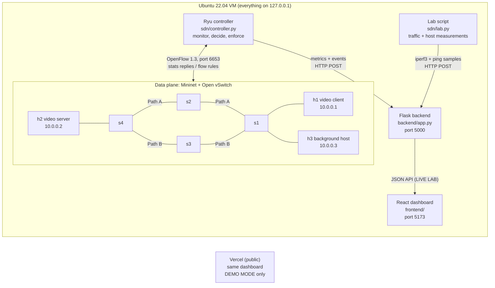

# SDN-Based QoS Management for Video Streaming

A small software defined network that protects a video stream from
congestion. A Ryu controller (OpenFlow 1.3) watches the load on every link
of a Mininet + Open vSwitch network. When the link carrying the video stays
above 80% for three polls in a row, the controller moves the video to the
other path and puts it in a priority queue. A best-effort baseline is
compared against the QoS-enabled run, and a React dashboard shows the
results.

College project (CSE, Software Defined Networks course). Live demo site
(DEMO MODE, sample data only): **https://sdn-qos.vercel.app**

## Architecture



The control loop, every 2 seconds: read port statistics, compute
throughput and utilization per link, check the threshold, and if the video
path is congested and the other path has room, install the new path
(make-before-break) with the video in the priority queue.

## Results (measured, experiment 20261025-211618)

12 runs of 60 s: baseline and QoS, light (3 Mbit/s) and heavy (9 Mbit/s)
background traffic, 3 runs each, all valid. Video: 4 Mbit/s UDP. Links:
10 Mbit/s. Mean of the 3 runs, window 20 to 50 s (range in brackets).

| Heavy load | Baseline | QoS | Measured by |
|---|---|---|---|
| Video received | 2.55 Mbit/s (2.2 to 3.24) | 4.0 Mbit/s | end host (iperf3) |
| Video packet loss | 36.2% (19 to 45) | 0% | end host (iperf3) |
| Video jitter | 0.566 ms | 0.074 ms | end host (iperf3) |
| Ping delay h1 to h2 | 31.4 ms, 58 probes lost | 0.115 ms, 0 lost | end host (ping) |
| Background traffic received | 7.16 Mbit/s, 20.5% loss | 9.0 Mbit/s, 0% loss | end host (iperf3) |
| Stalls / stall time | 6.3 / 7.1 s | 0 / 0 s | playout buffer MODEL |
| Congestion detected after load start | 5.8 s | 6.0 s | controller |
| Reroute after load start / rule install | none | 6.04 s / 11.1 ms | controller |

Under light load (no congestion) both modes delivered all the video with
0% loss and no reroute happened, which also shows there were no false
reroutes at 72% utilization.

How to read these honestly:
- Emulated network (Mininet on one VM). The video is a constant-rate
  iperf3 UDP stream, not a real encoded video, so there is no picture
  quality score (no MOS, SSIM or VMAF).
- Stalls come from a playout buffer model fed by the measured data per
  second, not from a real player.
- Delay, jitter and loss are measured on the end hosts. The controller
  only measures throughput, utilization and drop counters.
- 3 runs per case. The QoS gain depends on a free alternative path.

Full numbers: [docs/results/20261025-211618/](docs/results/20261025-211618/)
(summary.txt, summary.json, runs.csv, config used). Details and limits:
[docs/how-it-works.md](docs/how-it-works.md).

## Quick start

Requirements (see [docs/installation-guide.md](docs/installation-guide.md)):
Ubuntu 22.04, Python 3.10, Mininet 2.3, Open vSwitch 2.17, iperf3, Node.js
LTS. Ryu, Flask and the Python packages live in `./.venv`.

```
# once (why each step is needed: docs/installation-guide.md)
python3 -m venv .venv
.venv/bin/pip install "setuptools<58" wheel
.venv/bin/pip install --no-build-isolation -r sdn/requirements.txt
.venv/bin/pip install -r backend/requirements.txt
# then apply the one-line Ryu fix in .venv/.../ryu/app/wsgi.py (installation guide, problem 3)
cd frontend && npm ci && cd ..

# live lab: backend, dashboard, Ryu, Mininet and a traffic menu (asks for sudo once)
bash scripts/start_lab.sh              # QoS mode
bash scripts/start_lab.sh baseline     # best-effort baseline
bash scripts/start_lab.sh qos --auto   # also run the 60 s demo scenario
# open http://127.0.0.1:5173 and choose LIVE LAB
bash scripts/stop_lab.sh               # stop everything

# full experiment (12 runs, about 18 minutes, asks for sudo once)
bash scripts/run_experiments.sh
python3 sdn/print_summary.py

# tests (no sudo)
.venv/bin/python -m unittest discover -s sdn/tests
.venv/bin/python -m unittest discover -s backend/tests
cd frontend && npm test
```

Lab menu: `v` video on/off, `l` / `h` / `o` background light / heavy /
off, `a` 60 s auto scenario, `s` status, `m` restart in the other mode,
`c` Mininet CLI, `q` quit.

## Dashboard

Five pages: Overview, Topology, QoS monitoring, Experiments, Event logs.

- **LIVE LAB**: real data from the Flask backend only. If the backend or
  the controller is not reachable it shows a red error state, never demo
  numbers.
- **DEMO MODE**: invented sample data from one file
  (`frontend/src/demo/demoData.js`), with a yellow banner and a
  "DEMO DATA" stamp on every page and chart. The Vercel site opens in this
  mode because no lab runs behind it.

Every card shows where its numbers come from (controller, end hosts,
playout model, kernel tc counters or config).

## Repository layout

| Folder | Contents |
|---|---|
| `sdn/` | Ryu controller, Mininet topology, lab and experiment runners, analysis, unit tests |
| `backend/` | Flask API (ingest from Ryu and the lab, read API for the dashboard), tests |
| `frontend/` | React + Vite + Tailwind + Recharts dashboard, Vercel config |
| `config/` | `config.yaml`: every threshold, rate and port in one file |
| `scripts/` | start/stop lab, experiments, verification and cleanup scripts |
| `docs/` | how it works, review mapping, demo script, viva notes, deployment, results |
| `results/` | raw output of runs (not in git; copies of the final results are in `docs/results/`) |

## Documentation

- [How it works](docs/how-it-works.md): topology, control loop, queues, measurements, limitations
- [Mapping to the review decks](docs/mapping-to-reviews.md): every objective and where it is met
- [5 minute demo script](docs/demo-script.md)
- [Viva preparation](docs/viva.md)
- [Deployment](docs/deployment.md): Vercel, environment variables, safe live access
- [Progress log](docs/PROGRESS.md): every phase, what was tested, exact commands
- [Troubleshooting](docs/troubleshooting.md)

## Security

All services bind to 127.0.0.1. The OpenFlow port (6653) is never
exposed. The backend accepts pushed data only from this machine, supports
a Bearer token and a CORS allowlist, and refuses tunnelled requests unless
a token is set. The public site is static and contains no secrets.
